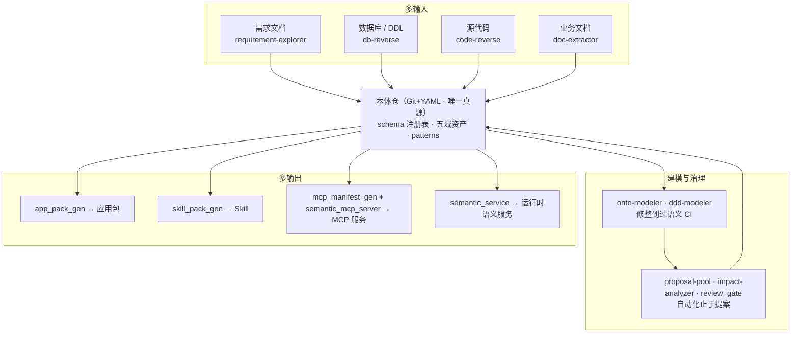

# All-agent —— 企业语义中台 + 建造/运行一体化平台

**All-agent = 企业语义中台 + 建造/运行一体化平台**：本体仓（Git+YAML）为唯一真源，多输入（需求 / 数据库 / 源代码 / 文档）多输出（应用包 / Skill / MCP / 分析报告 / 运行时语义服务），三循环自迭代。形态：**skill + 脚本，不建代码系统**——本仓没有业务代码，全部工程能力由 22 个确定性工具闸与 9 枚 agent skill 承载。

    

## 项目地图

| 仓库 | 角色 |
|---|---|
| **本仓** [all-agent](https://github.com/zzwcoding/all-agent) | 企业语义中台本体：本体仓 · 工具闸 · 技能（`skills/` 九枚） · 出口产物 · 施工史 |
| [petro-agent-platform](https://github.com/zzwcoding/petro-agent-platform) | 消费实例：其 `ontology/` 沿用本仓方法蓝本（fork 本仓 schema 与校验工具链，保留全部机器闸） |

## 功能架构



三循环自迭代：输入循环（逆向产草案）→ 治理循环（提案进、裁决出、真源更新）→ 输出循环（真源一键生成应用包/Skill/MCP/语义服务）。九枚 skill 全部按「深模块」纪律建造：卡 / 边界 / 依赖 / 输入输出契约 / 出厂集 / 归档。

## 文件架构

```
All-agent/
├── ontology/             # 本体仓（唯一真源）：schema 注册表 + 五域资产
│   ├── bohai/            #   渤海油田域（油气生产：井/计量/措施/报告…）
│   ├── his/              #   HIS 医院信息域
│   ├── hr/               #   人力资源域（组织/员工/薪酬/授权…）
│   ├── pkb/              #   个人知识库域
│   ├── patterns/ · schema/   # 可复用模式与本体 schema 注册表
├── skills/               # 九枚语义中台技能（requirement-explorer / doc-extractor /
│                         #   code-reverse / db-reverse / onto-modeler / ddd-modeler /
│                         #   impact-analyzer / proposal-pool / semantic-service）
├── tools/                # 确定性工具闸 22 个（每个配 test_* 出厂集测试）
│   ├── ci.sh             #   CI 总闸：全部闸一次跑完，红即不过
│   ├── schema_check.py   #   本体结构校验 · fixture_run.py 出厂集回归
│   ├── proposal_check.py #   提案预检 · check_citations.py 引文核对
│   ├── onboard_check.py  #   新窗口/新域接入自检（仓级 capability-manifest 防陈旧）
│   ├── review_gate.py · archive_check.py · guard_corpus_check.py · ddd_check.py …
│   ├── app_pack_gen.py · skill_pack_gen.py · mcp_manifest_gen.py   # 三类出口生成器
│   └── semantic_mcp_server.py · semantic_service_core.py · l5_score.py …
├── exports/              # 出口产物：devkit（bohai 开发套件）· mcp · skillpkg · reviews
├── specs/ · design/      # 模块卡与设计稿
├── policies/ · fixtures/ # 策略与出厂集
├── tickets/ · lessons/   # 施工票（252 提交的完整治理史）与教训账
├── docs/                 # prd（顶部状态行）· proposals/residual-questions.md 软警告台账 · reviews 批审查
├── references/ · diagrams/ · CONTEXT.md（术语表）· RESOURCES.md（信源清单）
└── AGENTS.md             # 任何 agent/新窗口的入口协议（先读我）
```

## 技术选型

| 层 | 选型 | 在项目中的角色 |
|---|---|---|
| 真源 | Git + YAML 本体仓 | 唯一真源——口径一处定义，多输出直接消费；改动一律走提案 MR |
| 形态 | skill + 脚本 | 不建代码系统：工程能力＝SKILL.md 工序 + Python 确定性闸 |
| 工具链 | Python（stdlib 优先） | 22 个工具闸，每个配出厂集测试（`tools/test_*.py` 19 件） |
| 出口协议 | MCP | semantic_mcp_server 把本体资产暴露为 MCP 服务（配 smoke client 与 manifest 生成器） |
| 质量闸 | ci.sh 总闸 + 提交前钩子（hooks/） | 约定不落闸等于没有——全部文本纪律落成可执行脚本 |
| 建造方法 | sdd-flow2 | 从 sdd-flow 分叉、专攻 skill+脚本形态的建造流；本仓即其第一个被治理对象（dogfooding） |

## 快速开始

```bash
git clone https://github.com/zzwcoding/all-agent.git
cd All-agent
bash tools/ci.sh                        # 全部闸一次跑完（红即不过）
python3 tools/onboard_check.py          # 新窗口/新域接入自检
python3 tools/schema_check.py           # 本体结构校验（单域或仓根）
```

把九枚技能装进你的 agent 技能目录：`python3 tools/install_skills.py`（装机登记见 `tools/install-registry.json`），或直接拷贝 `skills/<技能名>/` 到 `~/.claude/skills/`（Claude Code）／`~/.agents/skills/`（ZCode）。新窗口进入本仓请先读 `AGENTS.md` 入口协议。

## 组织架构（施工与治理）

- **建造流**：sdd-flow2 驱动，一票一提交，`tickets/` 留痕——252 个提交覆盖五个里程碑批次（bohai / his / hr / pkb / patterns），票 81 起引入子代理批审查（六面全 PASS 才收货：建模保真 / 拍板链合规 / 闸与导出 / 多域隔离 / 文档账实 / 提交声明抽验）。
- **治理纪律**：软警告与待 Owner 挂账逐条登记 `docs/proposals/residual-questions.md`（警告易失、台账可裁）；手写计数是漂移高危面，一律紧邻机取命令。
- **新窗口协议**：AGENTS.md → docs/prd.md 状态行 → CONTEXT.md → 报告当前阶段后**停下等拍板**。

## 文档指引

| 想看什么 | 去哪 |
|---|---|
| 仓库是什么 / 入口协议 | [AGENTS.md](AGENTS.md) |
| 术语表 / 信源清单 | `CONTEXT.md` · `RESOURCES.md` |
| PRD 与阶段状态 | `docs/prd.md`（顶部状态行） |
| 全部施工票与教训 | `tickets/` · `lessons/` |
| 软警告与挂账台账 | `docs/proposals/residual-questions.md` |
| 九枚技能的 SKILL.md 与参考件 | 本仓 `skills/` 目录 |
