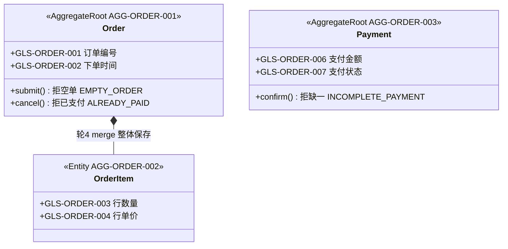
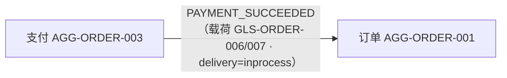
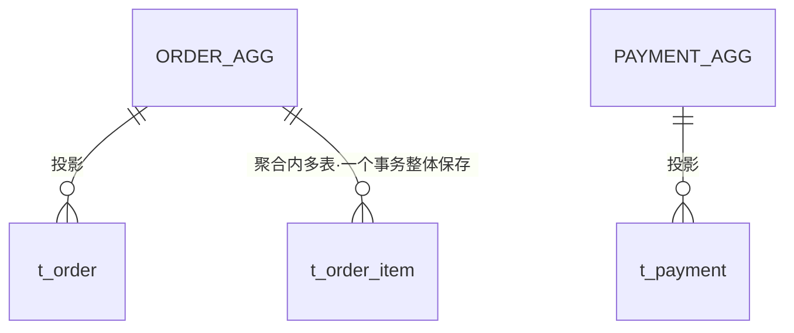

# 订单域走查 · Mermaid 三图（票 53 走查留痕件 5）

> 副产物：人审靠图，不靠逐行读 YAML（slicing-playbook §6；SKILL.md 工序步 5）。
> 导出规则：聚合卡→classDiagram（不变量方法入类，跨聚合引用不画线，只画事件流）；事件表→flowchart LR（生产聚合→事件→消费聚合，逐事件一链）；映射→erDiagram（聚合↔表投影）。
> 本件为走查演示件（真产物区运行时=design/ddd/<域>/diagrams.md，随《待人审清单》一起交 Owner）。

## 1. 聚合结构图（classDiagram ← 两张聚合卡）

> Order 与 Payment 之间**不画线**：跨聚合引用不画线（只看事件流图）；订单随支付变已支付是事件串联不是字段共享。

## 2. 跨聚合事件流图（flowchart LR ← 事件表）

> 事件表仅 PAYMENT_SUCCEEDED 一条（唯一跨聚合事件），故一链；ORDER_SUBMITTED/ORDER_CANCELLED 为订单聚合内部流转，不进表不画链（README §2，见走查主记录 §六）。

## 3. 聚合↔表投影图（erDiagram ← 表映射）

> 图例：ORDER_AGG=AGG-ORDER-001（订单），PAYMENT_AGG=AGG-ORDER-003（支付）。列级映射见件 3 表映射（列↔词条双向可解析）；写侧纪律：仅订单模块代码库写 t_order/t_order_item、仅支付模块代码库写 t_payment，跨聚合不 JOIN。
